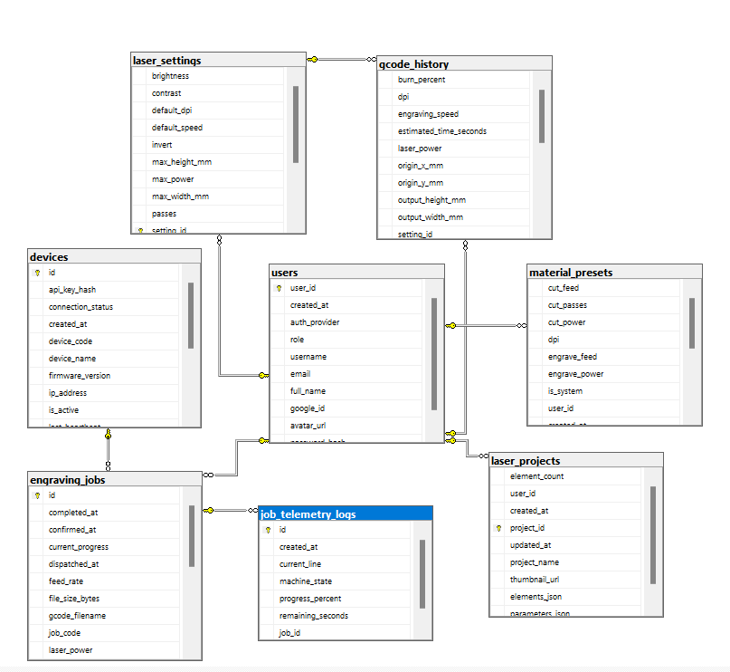

<div align="center">

# ⚙️ LaserGUI Backend — REST API, IoT Cloud & G-code Core Engine

### Máy chủ Dịch vụ Spring Boot 3, Điều phối Trạm máy IoT WebSocket STOMP & Công cụ sinh mã G-code bất đồng bộ với Java 21 Virtual Threads (Project Loom)

[](https://www.oracle.com/java/technologies/downloads/#java21)
[](https://spring.io/projects/spring-boot)
[](https://openjdk.org/projects/loom/)
[](https://stomp.github.io/)
[](https://www.microsoft.com/en-us/sql-server)
[](https://spring.io/projects/spring-security)
[](http://localhost:8080/swagger-ui/index.html)
[](https://github.com/AnVu05)
[](https://github.com/AnVu05)
[](LICENSE)

<br />

<p align="center">
  <b>LaserGUI Backend</b> là dịch vụ máy chủ trung tâm phụ trách xử lý thuật toán sinh mã G-code đa luồng siêu tốc, <b>điều phối trạm máy khắc Laser IoT từ xa qua WebSocket STOMP</b>, quản lý <b>hàng đợi gia công thông minh FIFO</b>, cơ chế <b>phê duyệt an toàn vật liệu 2 bước</b>, xác thực tính toàn vẹn <b>SHA-256</b> và cung cấp hệ thống xác thực bảo mật chuẩn Enterprise cho ứng dụng <b>LaserGUI Web Studio</b>.
</p>

</div>

---

## 🗄️ Sơ Đồ Cơ Sở Dữ Liệu (Database ERD Diagram)

Hệ thống cơ sở dữ liệu được thiết kế chuẩn hóa trên **Microsoft SQL Server**, liên kết khoá ngoại (Foreign Keys) chặt chẽ giữa bảng người dùng trung tâm, trạm thiết bị IoT và các bảng chức năng:

<div align="center">
  
</div>

### Đặc tả Chi tiết Các Bảng Dữ Liệu (Entities Specification)

| Tên Bảng (Table) | Khóa Chính (PK) | Quan Hệ (FK) | Chức Năng Chính |
| :--- | :--- | :--- | :--- |
| `users` | `user_id` (UUID) | — | Bảng trung tâm quản lý tài khoản người dùng, mã băm mật khẩu BCrypt, vai trò phân quyền (`ROLE_USER`, `ROLE_ADMIN`, `ROLE_OPERATOR`), nhà cung cấp xác thực (`LOCAL`, `GOOGLE`). |
| `devices` | `id` (BIGINT) | — | Quản lý trạm máy khắc laser IoT (Makerbase MKS DLC32 V2.1), mã token phần cứng băm BCrypt, địa chỉ IP mạng nội bộ, RSSI sóng Wi-Fi, trạng thái (`ONLINE`, `BUSY`, `OFFLINE`) và cấu hình phần cứng v2 (kích thước bàn, tốc độ tối đa, PWM tối đa). |
| `engraving_jobs` | `id` (BIGINT) | `user_id` $\rightarrow$ `users`<br>`device_id` $\rightarrow$ `devices` | Quản lý lệnh điều phối gia công, hàng đợi FIFO (`QUEUED`), trạng thái gia công 2 bước (`QUEUED` $\rightarrow$ `DISPATCHED` $\rightarrow$ `PRINTING` $\rightarrow$ `COMPLETED` / `CANCELLED` / `FAILED`), mã băm SHA-256 đối soát toàn vẹn, kích thước phôi và thông số F/S. |
| `job_telemetry_logs` | `id` (BIGINT) | `job_id` $\rightarrow$ `engraving_jobs` | Lưu vết telemetry tiến độ chi tiết theo thời gian thực: phần trăm tiến độ, dòng lệnh hiện tại, trạng thái máy, thời gian ước tính còn lại. |
| `laser_projects` | `project_id` (BIGINT) | `user_id` $\rightarrow$ `users` | Lưu trữ dữ liệu thiết kế bàn khắc 2D (khổ $300 \times 200\text{ mm}$), chuỗi JSON danh sách đối tượng (`elements_json`) và cấu hình tham số (`parameters_json`). |
| `gcode_history` | `history_id` (BIGINT) | `user_id` $\rightarrow$ `users` *(nullable)*<br>`setting_id` $\rightarrow$ `laser_settings` *(nullable)* | Quản lý lịch sử tạo mã và gia công: tổng số dòng lệnh, tốc độ cắt, công suất phát PWM, DPI, kích thước thực tế và liên kết file `.nc` vật lý. |
| `material_presets` | `preset_id` (BIGINT) | `user_id` $\rightarrow$ `users` *(nullable)* | Thư viện vật liệu mẫu hệ thống (`is_system = true`, 6 loại cơ bản) và vật liệu tùy chỉnh do người dùng tự thiết lập. |
| `laser_settings` | `setting_id` (BIGINT) | `user_id` $\rightarrow$ `users` *(nullable)* | Cấu hình tham số máy khắc mặc định: tốc độ gia công, gia tốc động cơ, giới hạn an toàn công suất PWM, khổ bàn làm việc. |

---

## 🚀 Tính Năng & Kiến Trúc Cốt Lõi (Key Capabilities)

### 1. ⚡ Xử Lý Đa Luồng Hiệu Năng Cao Với Java 21 Virtual Threads (Project Loom)
- Kích hoạt cơ chế ảo hóa luồng `spring.threads.virtual.enabled: true`.
- Toàn bộ các tác vụ tính toán nặng (biến đổi ma trận điểm ảnh raster $\rightarrow$ chuyển đổi tọa độ $\rightarrow$ xuất chuỗi lệnh G-code hàng vạn dòng $\rightarrow$ sinh mã băm SHA-256) được điều phối trên hàng nghìn **Virtual Threads (Loom)** siêu nhẹ, loại bỏ hoàn toàn nguy cơ tắc nghẽn luồng hệ điều hành (OS Carrier Threads) và tiết kiệm tối đa bộ nhớ RAM máy chủ.

### 2. 🌐 Hạ Tầng Điều Phối IoT Trực Tuyến Qua WebSocket STOMP
- **Kênh kết nối chuyên biệt**:
  - `/ws/device`: Dành riêng cho vi điều khiển Makerbase MKS DLC32 (ESP32) kết nối qua giao thức STOMP native.
  - `/ws/client`: Dành cho ứng dụng Web Client (React Vite), hỗ trợ tự động chuyển đổi giữa SockJS fallback và Native WebSocket.
- **Bảo mật kênh truyền**:
  - `DeviceEndpointHandshakeInterceptor`: Kiểm tra phiên bắt tay kết nối của thiết bị phần cứng.
  - `DeviceStompAuthenticationInterceptor`: Xác thực STOMP CONNECT frame bằng Token phần cứng đã băm BCrypt, ngăn chặn tuyệt đối các thiết bị lạ can thiệp vào hàng đợi gia công.
- **Chủ đề Pub/Sub thời gian thực (In-Memory Message Broker)**:
  - `/topic/job/{jobCode}/progress`: Truyền phát chỉ số tiến độ gia công (dòng lệnh, %, thời gian).
  - `/topic/job/{jobCode}/status`: Cập nhật trạng thái Job tức thời tới màn hình người dùng.
  - `/topic/device/{deviceCode}/commands`: Bắn lệnh khẩn cấp tức thời (PAUSE, RESUME, CANCEL, HOME, FRAME).
  - `/topic/device/{deviceCode}/config`: Đồng bộ cấu hình phần cứng v2 xuống vi điều khiển.

### 3. ⏳ Hàng Đợi Gia Công Thông Minh FIFO & Giải Quyết Máy Bận
- Khách hàng có thể liên tục gửi các yêu cầu khắc tới hệ thống ngay cả khi máy khắc đang bận thực hiện một lệnh gia công khác (chỉ cần trạm máy có trạng thái `ONLINE`).
- Hệ thống tự động xếp lệnh vào hàng đợi **FIFO (First-In, First-Out)** với trạng thái `QUEUED`, tự động cấp phát số thứ tự hàng đợi (`queuePosition`) và gửi thông báo thời gian thực về vị trí chờ cho người dùng.

### 4. 🛡️ Quy Trình Phê Duyệt An Toàn Vật Liệu 2 Bước & Xác Thực SHA-256
- **Safety Gate**: Yêu cầu gia công khi được điều phối sẽ không tự ý phát tia laser ngay mà chuyển sang trạng thái chờ xác nhận an toàn tại chỗ.
- **Xác thực toàn vẹn phần cứng SHA-256**: Máy chủ tự động tính toán mã băm SHA-256 cho toàn bộ nội dung tệp G-code và đính kèm vào Header `X-File-SHA256` khi trả file. Bo mạch MKS DLC32 tiến hành đối soát tính toàn vẹn bit-by-bit trước khi nạp vào bộ đệm phát tia.
- **Cơ chế Phê duyệt Quản trị viên**: Kỹ thuật viên/Admin trực tiếp kiểm tra phôi thực tế trên bàn máy, kiểm tra thấu kính tiêu cự và nhấn **"Phê duyệt & Vào máy"** (`POST /api/v1/jobs/{jobCode}/confirm`) để chuyển trạng thái sang `PRINTING`.

### 5. 📡 Tích Hợp Render IoT Gateway Client
- Cung cấp thành phần [RenderIotGatewayClient.java](file:///d:/Learn/Knowledge/OJT/src/backend/laser-engraving/src/main/java/com/anne/laserengraving/service/RenderIotGatewayClient.java) hoạt động như một cầu nối HTTP Gateway với dịch vụ Cloud trung gian:
  - Tự động chuyển tiếp lệnh điều khiển tức thời xuống bo mạch.
  - Truy vấn Telemetry thời gian thực từ bo mạch phục vụ việc giám sát liên tục.

### 6. 🔐 Bảo Mật Zero-XSS & Phân Quyền Vai Trò (RBAC)
- **HttpOnly Cookie Authentication**: JWT Access Token được lưu trữ an toàn trong `HttpOnly Cookie`, kết hợp `SameSite=Lax`, ngăn chặn hoàn toàn các cuộc tấn công đánh cắp phiên qua XSS.
- **Phân quyền vai trò (Role-Based Access Control)**:
  - `ROLE_USER`: Thiết kế bàn cắt, nạp dự án, gửi yêu cầu khắc vào hàng đợi, xem tiến độ Job cá nhân.
  - `ROLE_ADMIN` / `ROLE_OPERATOR`: Toàn quyền điều hành trạm máy, duyệt an toàn Job, hủy Job, cập nhật cấu hình thiết bị v2 và sinh lại token thiết bị.
- **Xác thực OTP qua Gmail**: Tích hợp dịch vụ email **Resend API**, tự động sinh mã OTP ngẫu nhiên 6 chữ số có hiệu lực trong 5 phút.

### 7. 🎯 Engine Sinh Mã G-Code Bất Đồng Bộ Chuẩn GRBL v1.1f
- Tiếp nhận tệp ảnh tải lên định dạng PNG, JPG, BMP qua cổng `POST /api/v1/gcode/generate`.
- Tự động áp dụng thuật toán phân tích điểm ảnh, chuẩn hóa Laser Mode `$32=1`, tọa độ tuyệt đối `G90`, đơn vị mm `G21`, điều chế xung tia `M3 S[0..1000]` và ngắt an toàn `M5`.
- Tự động lưu file nhị phân `.nc` vào thư mục lưu trữ cục bộ `storage/gcode/` có phân quyền và cung cấp endpoint tải xuống `GET /api/v1/gcode/download/{historyId}`.

---

## 🔌 Danh Mục RESTful API Endpoints Chi Tiết

Tài liệu tương tác trực tiếp Swagger UI có sẵn tại: `http://localhost:8080/swagger-ui/index.html`

### 1. Điều Phối Job Gia Công & Hàng Đợi IoT (`/api/v1/jobs`)
| Phương thức | Đường dẫn | Phân quyền | Mô tả chi tiết |
| :--- | :--- | :--- | :--- |
| `POST` | `/api/v1/jobs/dispatch` (Multipart) | Public / User | Điều phối Job khắc mới bằng cách tải file G-code lên (tự động tính SHA-256 & xếp hàng FIFO) |
| `POST` | `/api/v1/jobs/dispatch` (JSON) | Public / User | Điều phối Job khắc mới bằng chuỗi văn bản G-code trực tiếp trong JSON body |
| `GET` | `/api/v1/jobs` | Admin / Operator | Lấy danh sách toàn bộ Jobs trong hệ thống (Hỗ trợ lọc theo `deviceCode`) |
| `GET` | `/api/v1/jobs/{jobId}` | Public / User | Tra cứu chi tiết một Job theo ID |
| `GET` | `/api/v1/jobs/code/{jobCode}` | Public / User | Tra cứu chi tiết một Job theo Job Code (VD: `JOB-20261031-E1AD03AC`) |
| `GET` | `/api/v1/jobs/{jobId}/download` | PermitAll (Token) | Tải file G-code theo Job ID kèm Header `X-File-SHA256` để bo mạch đối soát toàn vẹn |
| `GET` | `/api/v1/jobs/code/{jobCode}/download` | PermitAll (Token) | Tải file G-code theo Job Code kèm Header `X-File-SHA256` |
| `POST` | `/api/v1/jobs/{jobCode}/confirm` | Admin / Operator | **Phê duyệt an toàn vật liệu tại chỗ**: Cấp quyền cho máy phát tia laser (`DISPATCHED` $\rightarrow$ `PRINTING`) |
| `POST` | `/api/v1/jobs/{jobCode}/cancel` | Admin / Operator | Hủy bỏ một Job gia công trong hàng đợi hoặc đang chạy |
| `GET` | `/api/v1/jobs/{jobCode}/telemetry` | Public / User | Lấy telemetry thời gian thực của Job từ IoT Gateway (tiến độ, tọa độ, cảm biến) |
| `POST` | `/api/v1/jobs/{jobCode}/command` | Public / User | Gửi lệnh điều khiển tức thời (`PAUSE`, `RESUME`, `CANCEL`, `HOME`) xuống máy qua Gateway |

### 2. Quản Lý Trạm Máy Khắc Laser IoT (`/api/v1/devices`)
| Phương thức | Đường dẫn | Phân quyền | Mô tả chi tiết |
| :--- | :--- | :--- | :--- |
| `GET` | `/api/v1/devices` | Public / User | Lấy danh sách các máy khắc Laser đang hoạt động trong hệ thống |
| `GET` | `/api/v1/devices/{deviceCode}` | Public / User | Tra cứu thông số kỹ thuật của một máy khắc cụ thể (VD: `LASER-HN-001`) |
| `PUT` | `/api/v1/devices/{deviceCode}/config` | Admin / Operator | Cập nhật cấu hình phần cứng v2 (Khổ X/Y, Feed max, Power max) và đồng bộ tới firmware |
| `POST` | `/api/v1/devices/{deviceCode}/token` | Admin / Operator | Tạo lại token thiết bị (token trả về 1 lần duy nhất để nhập vào Web Captive Portal) |
| `POST` | `/api/v1/devices/heartbeat` | PermitAll (Device) | Endpoint HTTP Fallback nhận nhịp tim Heartbeat từ bo mạch phần cứng |
| `POST` | `/api/v1/devices/{deviceCode}/commands` | Public / User | Phát lệnh điều khiển thời gian thực (`PAUSE`, `RESUME`, `CANCEL`, `HOME`, `FRAME`) xuống bo mạch |

### 3. Kênh WebSocket STOMP Endpoints
| Giao thức | Đường dẫn / Đích đến | Đối tượng | Mô tả chi tiết |
| :--- | :--- | :--- | :--- |
| `WS` | `/ws/device` | Bo mạch MKS DLC32 | Endpoint WebSocket Native dành riêng cho vi điều khiển ESP32 |
| `WS / SockJS` | `/ws/client` | Web Studio Frontend | Endpoint WebSocket hỗ trợ SockJS fallback cho trình duyệt |
| `STOMP IN` | `/app/device/heartbeat` | Bo mạch $\rightarrow$ Backend | Nhận gói tin Heartbeat PING cập nhật trạng thái sống của máy |
| `STOMP IN` | `/app/device/telemetry` | Bo mạch $\rightarrow$ Backend | Nhận dữ liệu tiến độ phần trăm, dòng lệnh hiện tại từ bo mạch |
| `STOMP IN` | `/app/device/status` | Bo mạch $\rightarrow$ Backend | Nhận thông báo cập nhật trạng thái gia công từ bo mạch |
| `STOMP IN` | `/app/device/config-applied` | Bo mạch $\rightarrow$ Backend | Xác nhận vi điều khiển đã nạp thành công cấu hình v2 |
| `STOMP OUT` | `/topic/job/{jobCode}/progress`| Backend $\rightarrow$ Web Client | Phát luồng tiến độ gia công thời gian thực |
| `STOMP OUT` | `/topic/job/{jobCode}/status` | Backend $\rightarrow$ Web Client | Phát cập nhật trạng thái Job thời gian thực |
| `STOMP OUT` | `/topic/device/{deviceCode}/commands` | Backend $\rightarrow$ Bo mạch | Phát lệnh điều khiển máy tức thời |
| `STOMP OUT` | `/topic/device/{deviceCode}/config` | Backend $\rightarrow$ Bo mạch | Phát cấu hình tham số phần cứng mới xuống bo mạch |

### 4. Xác Thực & Quản Lý Tài Khoản (`/api/v1/auth`)
| Phương thức | Đường dẫn | Phân quyền | Mô tả chi tiết |
| :--- | :--- | :--- | :--- |
| `POST` | `/api/v1/auth/register` | Public | Đăng ký tài khoản Gmail mới & gửi mã OTP 6 số |
| `POST` | `/api/v1/auth/verify-otp` | Public | Xác thực mã OTP, kích hoạt tài khoản & cấp HttpOnly Cookie |
| `POST` | `/api/v1/auth/resend-otp` | Public | Gửi lại mã kích hoạt sau 59 giây đếm ngược |
| `POST` | `/api/v1/auth/login` | Public | Đăng nhập tài khoản & thiết lập HttpOnly Cookie |
| `POST` | `/api/v1/auth/google` | Public | Đăng nhập hoặc đăng ký nhanh qua Google OAuth |
| `POST` | `/api/v1/auth/logout` | Authenticated | Đăng xuất an toàn & thu hồi HttpOnly Cookie |
| `GET` | `/api/v1/auth/me` | Authenticated | Lấy thông tin tài khoản đang đăng nhập |

### 5. Sinh Mã G-Code Bất Đồng Bộ (`/api/v1/gcode`)
| Phương thức | Đường dẫn | Phân quyền | Mô tả chi tiết |
| :--- | :--- | :--- | :--- |
| `POST` | `/api/v1/gcode/generate` | Public / User | Upload ảnh và biên dịch ra mã G-code bất đồng bộ với Virtual Threads |
| `GET` | `/api/v1/gcode/download/{historyId}` | Public / User | Tải tệp G-code vật lý `.nc` về máy tính |

### 6. Dự Án Bàn Khắc 2D Canvas (`/api/v1/projects`)
| Phương thức | Đường dẫn | Phân quyền | Mô tả chi tiết |
| :--- | :--- | :--- | :--- |
| `POST` | `/api/v1/projects` | Authenticated | Lưu mới hoặc cập nhật dự án bàn khắc kèm các đối tượng JSON |
| `GET` | `/api/v1/projects` | Authenticated | Lấy danh sách dự án của người dùng |
| `GET` | `/api/v1/projects/{projectId}` | Authenticated | Lấy thông tin chi tiết một dự án để nạp lên bàn khắc |
| `DELETE` | `/api/v1/projects/{projectId}` | Authenticated | Xóa vĩnh viễn dự án khỏi CSDL |

### 7. Lịch Sử Gia Công (`/api/v1/history`)
| Phương thức | Đường dẫn | Phân quyền | Mô tả chi tiết |
| :--- | :--- | :--- | :--- |
| `POST` | `/api/v1/history` | Public / User | Lưu thông số và mã G-code lịch sử sau khi hoàn tất gia công |
| `GET` | `/api/v1/history` | Authenticated | Lấy danh sách lịch sử có hỗ trợ phân trang (`page`, `size`) |
| `GET` | `/api/v1/history/{historyId}` | Authenticated | Xem chi tiết 1 bản ghi gia công |
| `DELETE` | `/api/v1/history/{historyId}` | Authenticated | Xóa bản ghi lịch sử |

### 8. Thư Viện Vật Liệu Mẫu (`/api/v1/materials`)
| Phương thức | Đường dẫn | Phân quyền | Mô tả chi tiết |
| :--- | :--- | :--- | :--- |
| `GET` | `/api/v1/materials` | Public / User | Lấy danh sách vật liệu mẫu (Hệ thống + Tùy chỉnh của người dùng) |
| `GET` | `/api/v1/materials/{id}` | Public / User | Lấy thông tin vật liệu theo ID |
| `GET` | `/api/v1/materials/key/{key}` | Public / User | Lấy thông số theo mã nhận diện key (VD: `mat-plywood`) |
| `POST` | `/api/v1/materials` | Authenticated | Tạo hồ sơ thông số vật liệu mới |
| `PUT` | `/api/v1/materials/{id}` | Authenticated | Chỉnh sửa thông số vật liệu tùy chỉnh |
| `DELETE` | `/api/v1/materials/{id}` | Authenticated | Xóa vật liệu tùy chỉnh |
| `POST` | `/api/v1/materials/init-defaults`| Admin / Operator | Nạp lại 6 vật liệu mẫu mặc định |

### 9. Cấu Hình Máy Laser (`/api/v1/settings`)
| Phương thức | Đường dẫn | Phân quyền | Mô tả chi tiết |
| :--- | :--- | :--- | :--- |
| `GET` | `/api/v1/settings` | Public / User | Lấy thông số vận hành mặc định của máy laser |
| `PUT` | `/api/v1/settings` | Admin / Operator | Cập nhật thông số giới hạn an toàn máy khắc |

---

## 📁 Cấu Trúc Thư Mục Backend

```text
src/backend/laser-engraving/
├── docs/                                       # Tài liệu & hình ảnh kiến trúc CSDL
│   └── images/
│       └── database-erd.png                    # Sơ đồ quan hệ thực thể (ERD) SQL Server
├── src/
│   ├── main/
│   │   ├── java/com/anne/laserengraving/
│   │   │   ├── config/                         # Cấu hình Spring Security, WebSocket, DataInitializer
│   │   │   │   ├── ApplicationConfig.java      # Cấu hình Bean hệ thống, Mã hóa mật khẩu BCrypt
│   │   │   │   ├── CorsConfig.java             # Cấu hình CORS cho Frontend Web Studio
│   │   │   │   ├── CookieJwtAuthenticationFilter.java # Bộ lọc trích xuất JWT từ HttpOnly Cookie
│   │   │   │   ├── DataInitializer.java        # Khởi tạo 6 vật liệu mẫu lúc khởi động
│   │   │   │   ├── DeviceEndpointHandshakeInterceptor.java # Handshake interceptor cho bo mạch
│   │   │   │   ├── DeviceStompAuthenticationInterceptor.java # Xác thực STOMP Connect token
│   │   │   │   ├── OpenApiConfig.java          # Cấu hình Swagger OpenAPI 3.0
│   │   │   │   ├── SecurityConfig.java         # Chuỗi lọc bảo mật Spring Security & RBAC
│   │   │   │   ├── VirtualThreadConfig.java    # Kích hoạt Java 21 Project Loom
│   │   │   │   ├── WebMvcConfig.java           # Định cấu hình Spring MVC
│   │   │   │   └── WebSocketConfig.java        # Định cấu hình Broker STOMP /ws/device & /ws/client
│   │   │   ├── controller/                     # Tầng điều hướng REST API & WebSocket
│   │   │   │   ├── AuthController.java         # Đăng nhập, Đăng ký OTP, Google OAuth
│   │   │   │   ├── DeviceRestController.java   # REST API quản lý thiết bị IoT & cấu hình v2
│   │   │   │   ├── DeviceWebSocketController.java # Xử lý thông điệp STOMP từ bo mạch phần cứng
│   │   │   │   ├── GcodeController.java        # Sinh mã G-code bất đồng bộ
│   │   │   │   ├── HistoryController.java      # Lịch sử gia công
│   │   │   │   ├── JobController.java          # Điều phối Job, Hàng đợi FIFO & Phê duyệt an toàn
│   │   │   │   ├── LaserSettingsController.java# Tham số vận hành máy
│   │   │   │   ├── MaterialPresetController.java# Danh mục vật liệu mẫu
│   │   │   │   └── ProjectController.java      # Lưu trữ dự án bàn khắc 2D
│   │   │   ├── dto/                            # Đối tượng truyền dữ liệu (Data Transfer Objects)
│   │   │   │   ├── device/                     # DTO phản hồi thông số thiết bị IoT
│   │   │   │   ├── request/                    # DTO yêu cầu gửi vào từ Client
│   │   │   │   ├── response/                   # DTO phản hồi chuẩn hóa ApiResponse
│   │   │   │   └── websocket/                  # DTO thông điệp WebSocket (Heartbeat, Progress, Status)
│   │   │   ├── entity/                         # Thực thể JPA ánh xạ CSDL SQL Server
│   │   │   │   ├── DeviceEntity.java           # Trạm máy khắc laser IoT
│   │   │   │   ├── EngravingJobEntity.java     # Lệnh gia công khắc & hàng đợi FIFO
│   │   │   │   ├── GcodeHistoryEntity.java     # Lịch sử G-code
│   │   │   │   ├── JobTelemetryLogEntity.java  # Nhật ký telemetry tiến độ gia công
│   │   │   │   ├── LaserSettingsEntity.java    # Cấu hình máy laser
│   │   │   │   ├── MaterialPresetEntity.java   # Vật liệu mẫu
│   │   │   │   ├── ProjectEntity.java          # Dự án thiết kế 2D
│   │   │   │   └── UserEntity.java             # Tài khoản người dùng & phân quyền RBAC
│   │   │   ├── exception/                      # Bộ xử lý ngoại lệ toàn cục (Global Exception Handler)
│   │   │   ├── repository/                     # Giao diện truy vấn Spring Data JPA
│   │   │   ├── security/                       # Triển khai JWT Token Provider, Cookie helper
│   │   │   ├── service/                        # Tầng nghiệp vụ xử lý logic
│   │   │   │   ├── AuthService.java            # Quản lý tài khoản, mật khẩu, JWT
│   │   │   │   ├── DeviceCredentialService.java# Quản lý & xác thực Token thiết bị phần cứng
│   │   │   │   ├── DeviceService.java          # Trạng thái máy IoT, nhịp tim, đồng bộ cấu hình v2
│   │   │   │   ├── FileStorageService.java     # Lưu trữ và phục vụ tải file G-code bảo mật
│   │   │   │   ├── GcodeService.java           # Engine phân tích ảnh & sinh G-code đa luồng
│   │   │   │   ├── HistoryService.java         # Quản lý nhật ký gia công
│   │   │   │   ├── JobService.java             # Quản lý hàng đợi FIFO, điều phối Job & duyệt an toàn
│   │   │   │   ├── JobTelemetryService.java    # Tiếp nhận & broadcast telemetry tiến độ thời gian thực
│   │   │   │   ├── LaserSettingsService.java   # Tham số vận hành máy
│   │   │   │   ├── MailService.java            # Gửi mã OTP qua Resend API
│   │   │   │   ├── MaterialPresetService.java  # Quản lý danh mục vật liệu
│   │   │   │   ├── ProjectService.java         # Lưu trữ & phục hồi dự án bàn khắc
│   │   │   │   └── RenderIotGatewayClient.java # Cầu nối Gateway chuyển tiếp lệnh & telemetry từ xa
│   │   │   └── LaserEngravingApplication.java  # Điểm khởi động Spring Boot
│   │   └── resources/
│   │       ├── application.yaml                # Cấu hình máy chủ, CSDL SQL Server, Virtual Threads & Port
│   │       └── application-local.yaml          # Cấu hình phát triển cục bộ
│   └── test/                                   # Bộ kiểm thử tự động (Unit & Integration Tests)
├── storage/                                    # Thư mục lưu trữ các tệp G-code .nc vật lý
│   └── gcode/
├── mvnw & mvnw.cmd                             # Maven Wrapper thực thi không cần cài đặt Maven
└── pom.xml                                     # Quản lý thư viện phụ thuộc dự án
```

---

## 🛠️ Yêu Cầu Môi Trường & Cài Đặt (Prerequisites)

1. **Java Development Kit (JDK)**:
   - Phiên bản: **Java 21 LTS** (Oracle JDK hoặc Eclipse Temurin).
   - Kiểm tra phiên bản: `java -version`.
2. **Cơ sở dữ liệu**:
   - **Microsoft SQL Server** (2019, 2022 hoặc SQL Server Express).
   - Đã tạo sẵn Database có tên: `LASER`.
   - Tài khoản người dùng: `sa` (Mật khẩu: `sa` hoặc cấu hình tùy biến qua biến môi trường).

---

## 🚀 Hướng Dẫn Khởi Chạy Ứng Dụng (Quick Start)

### 1. Cấu hình Cơ sở dữ liệu (application.yaml)
Cấu hình mặc định kết nối đến SQL Server cục bộ trên cổng `1433`:

```yaml
spring:
  datasource:
    url: ${SPRING_DATASOURCE_URL:jdbc:sqlserver://localhost:1433;databaseName=LASER;encrypt=true;trustServerCertificate=true}
    username: ${SPRING_DATASOURCE_USERNAME:sa}
    password: ${SPRING_DATASOURCE_PASSWORD:sa}
    driver-class-name: com.microsoft.sqlserver.jdbc.SQLServerDriver
  jpa:
    hibernate:
      ddl-auto: ${SPRING_JPA_HIBERNATE_DDL_AUTO:update}
  threads:
    virtual:
      enabled: true
```

*Bạn có thể ghi đè các tham số này thông qua các biến môi trường hệ thống mà không cần sửa code.*

### 2. Khởi chạy máy chủ Spring Boot

```bash
# Di chuyển vào thư mục backend
cd src/backend/laser-engraving

# Chạy ứng dụng bằng Maven Wrapper (Windows PowerShell)
.\mvnw spring-boot:run

# Hoặc trên Linux / macOS:
./mvnw spring-boot:run
```

Sau khi khởi chạy thành công, máy chủ lắng nghe tại:
- **REST API Base URL**: `http://localhost:8080/api/v1`
- **WebSocket STOMP Broker**: `http://localhost:8080/ws/client` và `ws://localhost:8080/ws/device`
- **Tài liệu Swagger UI**: `http://localhost:8080/swagger-ui/index.html`
- **OpenAPI Schema JSON**: `http://localhost:8080/v3/api-docs`

### 3. Chạy toàn bộ Bộ kiểm thử tự động (Automated Tests)

```bash
.\mvnw test
```

---

## 👨‍💻 Thông Tin Tác Giả & Đơn Vị Phát Triển

- **Tác giả phát triển**: **Vũ Đình Ân**
- **GitHub**: [@AnVu05](https://github.com/AnVu05)
- **Đơn vị OJT / Nghiên cứu**: **HYPERDATA LAB**
- **Dự án**: Nghiên cứu & Chế tạo Ứng dụng Web Điều khiển Máy Khắc Laser CNC phục vụ đồ án OJT.

---

## 📄 Giấy Phép (License)

Dự án được phân phối dưới giấy phép **MIT License**. Bạn được tự do sử dụng, chỉnh sửa và tích hợp cho mục đích học tập và nghiên cứu. Chi tiết xem tại tệp `LICENSE`.

<div align="center">
  <sub>Xây dựng với Java 21, Spring Boot, WebSocket STOMP và niềm đam mê công nghệ phần mềm chuyên sâu 🚀</sub>
</div>
